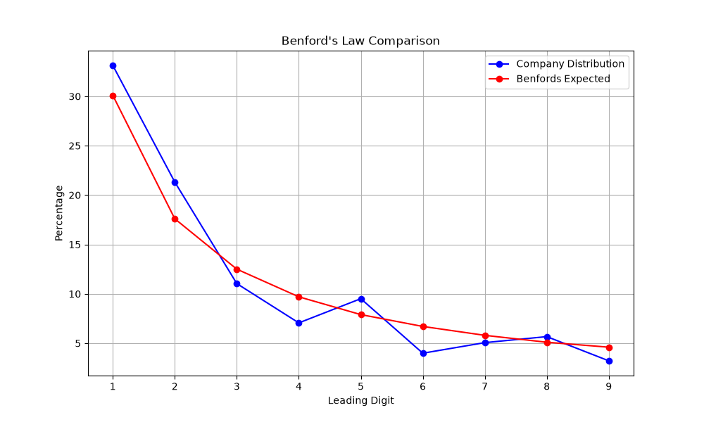

## What I built

A `pdftotext` + Python pipeline that extracts every number from a company's
financial disclosure and runs a chi-square goodness-of-fit test against
Benford's Law. Naturally-arising figures follow a predictable digit
distribution; fabricated ones usually don't. Real auditors use this as a cheap
screen for fraud.

## Results on a real document

Ran against a National Stock Exchange of India compliance letter (6,513 lines):

- **Extracted 652 leading digits in 2.6 seconds**
- **Chi² = 3.98, p = 0.859**
- **Verdict: Conforms to Benford's Law — no statistical anomaly**

## Honest caveats

Works only on machine-readable PDFs (scanned documents need OCR first). One
document passing doesn't prove the company is clean — it validates the tool.

<a href="https://github.com/NimeshXTV/benford-analysis" target="_blank" class="cactus-link font-bold">View the source on GitHub →</a>
